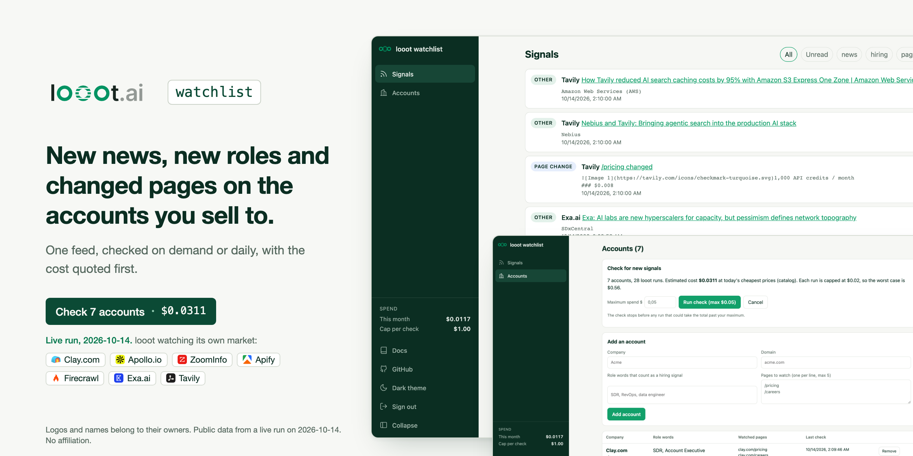
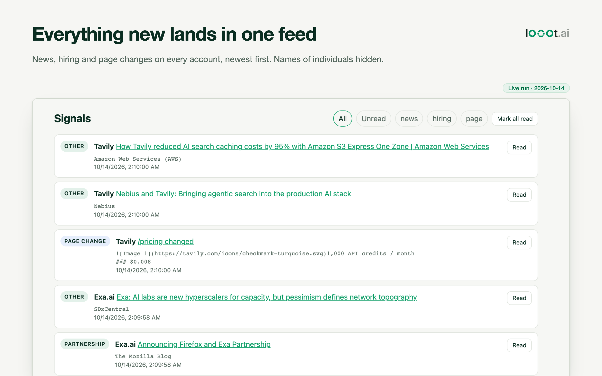
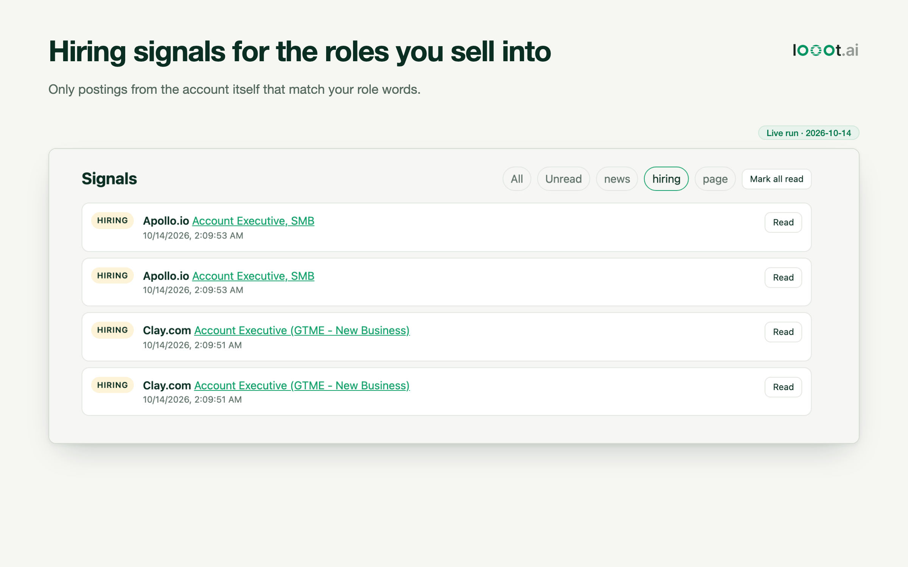
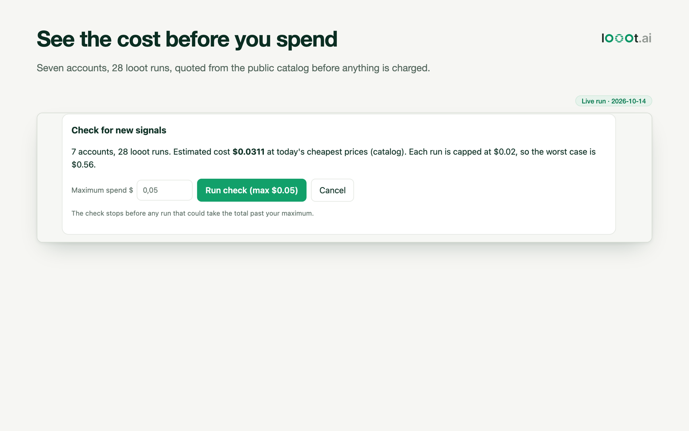
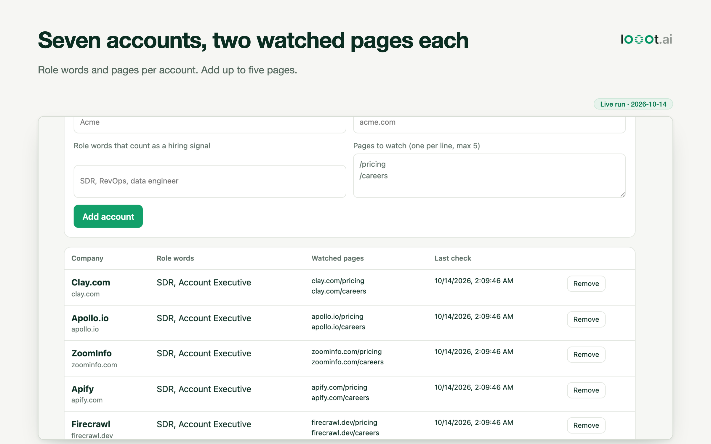
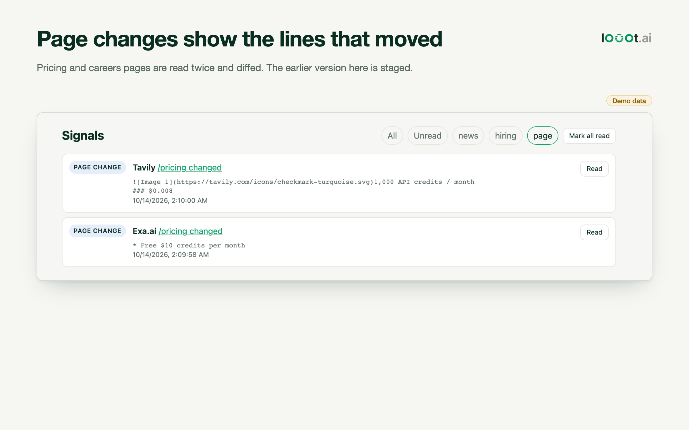
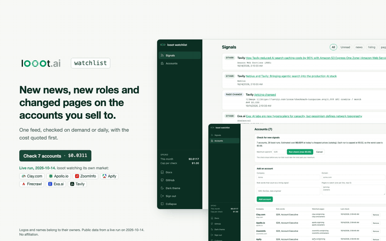

<p align="center"></p>

<p align="center"><sub>Logos and names belong to their owners. Public data from a live run on 2026-10-14. No affiliation.</sub></p>

| | |
|---|---|
|  |  |
|  |  |
|  | |

<p align="center"></p>

[Watch the walkthrough as MP4](docs/media/demo.mp4)

# looot watchlist

[](LICENSE) [](https://github.com/loootai/looot-watchlist/releases) [](https://docs.looot.ai)

[](https://vercel.com/new/clone?repository-url=https%3A%2F%2Fgithub.com%2Floootai%2Flooot-watchlist&env=NEXT_PUBLIC_SUPABASE_URL,NEXT_PUBLIC_SUPABASE_ANON_KEY,LOOOT_TOKEN&envDescription=Supabase%20project%20URL%20and%20anon%20key%2C%20plus%20a%20looot%20agent%20token&envLink=https%3A%2F%2Fgithub.com%2Floootai%2Flooot-watchlist%23set-up&project-name=looot-watchlist&repository-name=looot-watchlist)

An open-source account watchlist for sales teams. You list the companies you sell to, and it checks each one for new news (funding, executive changes, launches, layoffs), new job posts that match the roles you care about, and changes on the pages you watch, such as `/pricing` or `/careers`. Everything new lands in one feed.

It runs on Next.js and Supabase (auth and Postgres), deploys to Vercel, and gets its data from [looot](https://looot.ai): one key and one prepaid balance for 2,500+ data API endpoints. A check of one account with two watched pages costs about $0.004 at the prices below. There is no seat price.

## What it does

- Sign in with email and password (Supabase Auth). Each user sees only their own accounts and signals: row level security on every table, `owner_id = auth.uid()`.
- Add an account: company name, domain, role words (`SDR, RevOps`), up to 5 pages to watch.
- Get a quote, confirm a maximum spend, run the check. The first check of an account records a baseline; later checks create signals for what is new.
- Read the feed, filter by type or account, mark signals read.
- Optional daily check through Vercel Cron, with its own spend cap.

## What one check runs

| Signal | looot job | Input | Price used for the quote (2026-10-08) |
|---|---|---|---|
| News | `job:news.search` | `"<company name>"` | $0.00099 per call |
| Hiring | `job:jobs.search` (only when role words are set) | company name plus role words | $0.00145 ($0.0005 per call, or $0.000145 per result x 10) |
| Page change | `job:web.scrape.markdown` per watched page | the page URL | $0.001 ($0.0002 per call, or $0.001 per page result) |

Prices come from the free public catalog (`GET https://api.looot.ai/v1/catalog/overview?depth=jobs`), cached for an hour, with the dated prices above as a fallback. The quote takes the higher of the per-call and per-result price, so it errs high. Each run uses `fallback` so looot tries the next provider when one misses.

## Spending rules

1. `/api/quote` (free) counts the runs and prices them.
2. The user confirms a maximum spend. `/api/check` refuses (HTTP 409) before any paid call when the estimate is above it.
3. Every run is capped with `fallback.maxCostUsd` (`PER_RUN_CAP_USD`, default $0.02). Before each run the checker lowers the cap to what is left of the maximum and stops when the next run no longer fits. The total cannot pass the confirmed maximum.
4. `MAX_CHECK_COST_USD` (default $1) caps any manual check; `CRON_MAX_COST_USD` (default $0.50) caps the daily run across all users.
5. Idempotency keys carry the account and the date, so a second check on the same day replays the stored runs at no cost.

`LOOOT_TOKEN` is read only in route handlers (`src/lib/looot.ts`, `src/app/api/*`). It is never sent to the browser: the build was checked with a canary token and `grep -r` over `.next/static` finds nothing.

## Set up

You need a Supabase project, a looot agent token, and Node 20 or newer.

1. Create a Supabase project. In Project Settings, API, copy the project URL and the anon key.
2. Apply the schema, from a clone of this repo:

   ```bash
   npx supabase@2.118.0 login
   npx supabase@2.118.0 link --project-ref <your-project-ref>
   npx supabase@2.118.0 db push
   ```

   Or paste `supabase/migrations/20261008000000_init.sql` into the SQL editor and run it.
3. Create a looot agent token at https://looot.ai/settings with `catalog.read`, `runs.read` and `runs.execute`, and top up from $5.
4. Copy `.env.example` to `.env.local`, fill in the three values, then:

   ```bash
   npm ci
   npm run dev
   ```

5. Deploy: click the Vercel button above, or import the repo in Vercel and set the same three variables.

### Daily check (optional)

`vercel.json` schedules `GET /api/cron` at 07:00 UTC. It does nothing until you set two more variables in Vercel:

- `CRON_SECRET`: any long random string. Vercel sends it as `Authorization: Bearer <CRON_SECRET>`.
- `SUPABASE_SERVICE_ROLE_KEY`: the service role key from Project Settings, API. Only the cron route uses it; it sets `owner_id` on every row itself.

## Live run

On 2026-10-14 I watched seven of looot's neighbours: Clay.com, Apollo.io, ZoomInfo, Apify, Firecrawl, Exa.ai and Tavily. Each account had the role words `SDR, Account Executive` and two pages, `/pricing` and `/careers`.

- The quote said 28 runs and $0.0311.
- The first check made 28 looot calls and the app's cost log says $0.0117. It recorded a baseline for all seven accounts and created no signals, as designed. It stored 88 items.
- Second check: I removed the two newest headlines per account and the hiring items for Clay and Apollo from the stored baseline, then checked again the same day. The idempotency keys replayed the stored runs, which created 20 signals from real results: 14 news, 4 hiring and 2 page changes. That replay is the only reason the feed has anything in it. A real second check on a later day would show what is actually new.
- Screens made on a local stand-in for Supabase (a small script that answers the auth and REST calls from memory), because I did not run Docker or a Supabase project. The app code ran unchanged.

What worked:
- News was good for every account: ten distinct links each, with sources such as SiliconANGLE, PR Newswire and the Mozilla Blog. Tags found funding (Firecrawl) and partnership (Exa). Most headlines get the tag `other`.
- Hiring found postings only for Clay and Apollo.io (two each). The other five returned nothing that passed the employer and role filter.

What was weak:
- The same posting shows up twice when the job board lists it under two URLs (Clay and Apollo above). The app dedupes by URL, not by title.
- The two page-change signals on the pricing pages of Tavily and Exa are Demo data. One day gives no real second read, so I edited the stored first version of those two pages and let the live read of today diff against it. The lines shown are real text from the live pages, the "change" is staged. The diff of a markdown page also shows raw image links.
- A replayed check records its estimated spend in the monthly total again. The check_runs row of the replay said $0.0117; I did not confirm what looot charged for replayed runs. I set that row to $0 before taking the screenshots.
- Names of individuals in two headlines are replaced with "[name hidden]" in the images.

Everything in the images is from this run except the page-change card, which is labelled Demo data.

## Tests

```bash
npm test            # vitest, looot mocked: 30 tests
npm run typecheck   # tsc --noEmit
npm run test:rls    # needs initdb/pg_ctl/psql: applies the migration to a throwaway Postgres and checks RLS
npm run build
```

The tests cover the looot client (request shape, polling, errors), price parsing, result extraction for several provider shapes, page change detection, the baseline rule, the spend guard (refuse above the maximum, never pass it while running) and failure handling.

## Limits

- Provider answers differ. `src/lib/extract.ts` finds the first list of items with a link and a title, which covers the common news and job shapes. If a provider answers in a shape it misses, the signal is lost, not invented.
- The first live looot run is described in Live run above. No live Supabase project was used, so start with one account on yours.
- Job board results mix in other employers. Postings are kept only when the employer name matches the account and the title matches a role word.
- Page change detection ignores dates and times but not other text that changes on every load. Watch stable pages.

## Layout

```
src/lib/looot.ts        looot client: run job:<id> with fallback and a cost cap, poll the run
src/lib/checker.ts      plan runs, estimate, spend guard, diff against what was seen
src/lib/extract.ts      read items and page text from provider answers, tag headlines
src/lib/prices.ts       prices from the public catalog
src/app/api/quote       free quote
src/app/api/check       paid check after confirmation
src/app/api/cron        daily check (Vercel Cron)
supabase/migrations     schema and row level security
```

## License

MIT. See [LICENSE](LICENSE). Built by [looot](https://looot.ai).
